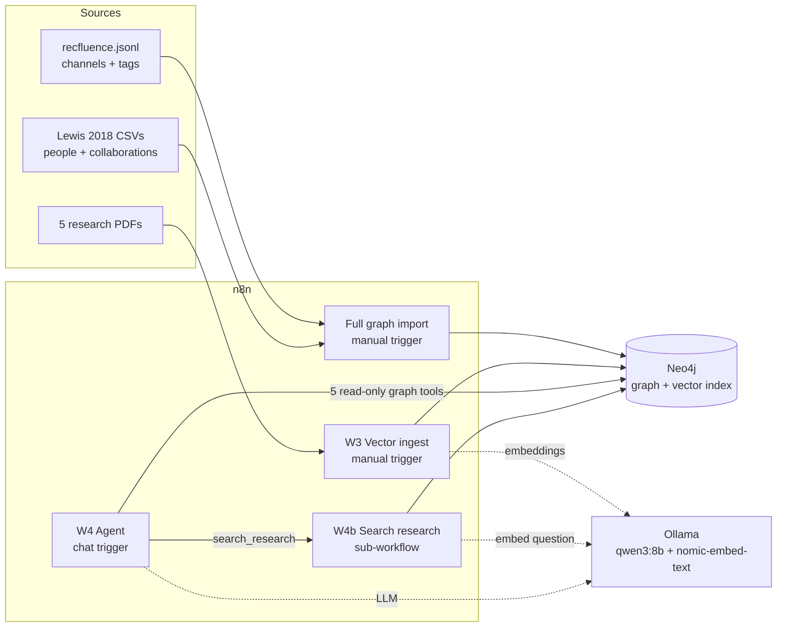
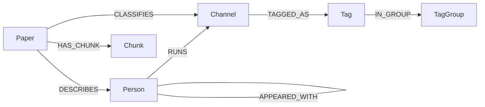

# Alternative Influence Explorer

A graph + vector RAG system about the YouTube "radicalization pipeline" debate. An AI agent answers questions about how political YouTubers were connected, how researchers classified their channels, and what the research actually concluded. Every answer cites its source.

Built with **Neo4j** (graph database and vector index in one), **n8n** (ingestion workflows and the agent), and **Ollama** (local LLM and embeddings).

> School project (datamatiker, two-week RAG project). The data describes how *researchers* classified public YouTube channels. It is not a verdict on any person's beliefs.

---

## What it can answer

| Question | What the agent uses |
|---|---|
| *Who is Dave Rubin, and how are his channels classified?* | Graph: `Person → Channel → Tag → TagGroup` |
| *Who did Jordan Peterson appear with?* | Graph: `APPEARED_WITH` edges with confidence and video evidence |
| *How is Jordan Peterson connected to Richard Spencer?* | Graph: shortest path over collaborations |
| *What does the WhiteIdentitarian tag mean, and who in the network has it?* | Graph: tag definitions and group |
| *Does YouTube's algorithm push people towards extreme content?* | Vector: passages from five papers, balanced across all of them |
| *Recommend me channels like X.* | Refuses: the agent describes research, it doesn't make viewing recommendations |

The graph answers *who is connected to whom and how they were labelled*. The vectors answer *what the research says*. Questions such as "how was this channel classified, and what do the papers conclude about channels like it?" need both.

---

## Architecture



### Graph schema



| Node | Count | From |
|---|---|---|
| `Channel` | 659 | Recfluence: human-reviewed channels with 100k+ subscribers, plus every channel in the Lewis network |
| `Tag` / `TagGroup` | 18 / 5 | Recfluence tags, grouped in this project (Political lean, Media type, Culture-war stance, Fringe, Identity focus) |
| `Person` | 65 | Lewis (2018): 60 in the network figure, 5 named only in the appendix |
| `Paper` | 5 | The research papers |
| `Chunk` | a few hundred | Paper text, about 1000 characters each, with a 768-dimensional embedding |

| Relationship | Count | Carries |
|---|---|---|
| `TAGGED_AS` | 1004 | `source` |
| `IN_GROUP` | 18 | |
| `RUNS` | 57 | Lewis' channel name, renamed-channel notes |
| `APPEARED_WITH` | 471 | `confidence` (high/medium/check), video `evidence`, period 2017-01-01 to 2018-04-01 |
| `DESCRIBES`, `CLASSIFIES`, `HAS_CHUNK` | | Links papers to the people, channels and text they cover |

Run `CALL db.schema.visualization();` in Neo4j Browser to see it drawn.

---

## Data sources

Seven sources, within the project's limit of ten.

| # | Source | Used for |
|---|---|---|
| 1 | **Recfluence** classified channels, Ledwich & Zaitsev ([TransparencyTube](https://github.com/markledwich2/TransparencyTube)) | `Channel`, `Tag`, political lean, human/auto label source |
| 2 | **Lewis (2018)**, *Alternative Influence*, Data & Society ([report](https://datasociety.net/library/alternative-influence/)) | `Person`, `RUNS`, `APPEARED_WITH`, and a paper for the vector side |
| 3 | Ribeiro et al. (2020), *Auditing Radicalization Pathways on YouTube* ([arXiv 1908.08313](https://arxiv.org/abs/1908.08313)) | Vector: evidence for the pipeline |
| 4 | Ledwich & Zaitsev (2019), *Algorithmic Extremism* ([arXiv 1912.11211](https://arxiv.org/abs/1912.11211)) | Vector: evidence against an algorithmic pipeline |
| 5 | Hosseinmardi et al. (2021), PNAS ([arXiv 2011.12843](https://arxiv.org/abs/2011.12843)) | Vector: demand-side explanation |
| 6 | Chen et al. (2023), Science Advances ([arXiv 2204.10921](https://arxiv.org/abs/2204.10921)) | Vector: subscriptions and external links |
| 7 | Recfluence tag definitions ([README](https://github.com/markledwich2/Recfluence)) | Tag descriptions (paraphrased) |

### How the Lewis network was extracted

Lewis publishes her collaboration network only as a figure, not as data. The edges were measured from the figure's pixels and validated three ways:

- All 23 collaborations the report cites with a video link were found.
- The one pair the report says never collaborated was rejected.
- Node size and colour in the original figure encode network centrality, and recomputing it on the extracted graph matches closely (Spearman ρ 0.90 and 0.95).

Each edge stores its confidence. Details are in [`docs/lewis_extraction.md`](docs/lewis_extraction.md), and an overlay of the extracted edges on the original figure is in `data/lewis_edges_overlay.png`.

---

## Workflows

| Workflow | Trigger | Does |
|---|---|---|
| **Full graph import** | Manual | Wipes the database. Creates constraints, the 18 tags and 5 tag groups, and the vector index. Imports the channels, then people, `RUNS` and `APPEARED_WITH`. One click rebuilds the whole graph in the right order. |
| **W3 Vector ingest** | Manual | Reads every PDF and recognises each paper. Drops the reference list, then chunks the text (~1000 characters, 150 overlap). Embeds the chunks with `nomic-embed-text` in batches of 24 and stores `Paper` and `Chunk` nodes. |
| **W4 Pipeline research assistant** | Chat | AI agent (`qwen3:8b`) with chat memory and six tools |
| **W4b Search research** | Called by W4 | Embeds the question, queries the vector index, and returns the best 2 passages **per paper** with citations |

The separate `W1_reset_schema`, `W2_step1` and `W2_steps2-4` workflows are the same steps as the full import, split up. You only need them to run a single step.

Every workflow has sticky notes explaining what each part does and why.

### Agent tools

| Tool | Type | Returns |
|---|---|---|
| `find_person` | Graph | A person's channels, tags with group and meaning, lean, channels missing from Recfluence |
| `person_collaborators` | Graph | Who they appeared with, confidence, video evidence, collaborators' tags |
| `find_channel` | Graph | Tags, lean, human/auto label, reviewer and creator notes, who runs it |
| `path_between` | Graph | Shortest collaboration chain between two people |
| `tag_overview` | Graph | Tag meaning, group, number of channels, people in the network with it |
| `search_research` | Vector | Relevant passages from all five papers, cited as Author (year) |

---

## Setup

### Prerequisites
- **Docker Desktop**, running n8n (tested on n8n 2.x)
- **Neo4j Desktop**, with a 2025.x instance
- **Ollama**, with these models:
  ```bash
  ollama pull qwen3:8b
  ollama pull nomic-embed-text
  ```
- 16 GB of RAM is enough for everything at once.

### 1. Start n8n with the data folder mounted

`docker-compose.yml`. The folder holding `data/` and the PDFs is mounted as `/files`:

```yaml
services:
  n8n:
    image: n8nio/n8n:latest
    container_name: n8n
    restart: unless-stopped
    ports:
      - "5678:5678"
    environment:
      - N8N_RESTRICT_FILE_ACCESS_TO=/files
    volumes:
      - n8n_data:/home/node/.n8n
      - "/path/to/this/repo/data:/files"

volumes:
  n8n_data:
```

```bash
docker compose up -d
docker exec -it n8n ls /files   # should list recfluence.jsonl, the CSVs and the PDFs
```

### 2. Get the data
- **Recfluence:** download the classified channels from [TransparencyTube](https://github.com/markledwich2/TransparencyTube) and save it as `data/recfluence.jsonl`.
- **PDFs:** download the five papers (links in the source table) into `data/`. The arXiv filenames (`1908.08313v4.pdf` etc.) are recognised automatically. The PDFs are not committed to this repo; get them from the original publishers.
- **Lewis CSVs:** already in `data/`.

### 3. Import the workflows
In n8n: **⋯ → Import from File** for each JSON in `workflows/`. Then:
- Create a **Basic Auth** credential with your Neo4j username and password, and select it in every node named *Neo4j: …* and in the five graph tool nodes.
- Create an **Ollama** credential with base URL `http://host.docker.internal:11434`, for the agent's chat model.
- **Publish** *W4b Search research*. W4 calls the published version.
- In W4, open the `search_research` node and select *W4b* as the workflow.

All URLs use `host.docker.internal`, because Neo4j and Ollama run on the Mac while n8n runs in Docker.

### 4. Build the database
1. Run **Full graph import**.
2. Run **W3 Vector ingest**, which takes a few minutes.

Then check in Neo4j Browser:
```cypher
MATCH (n) RETURN labels(n), count(*);
MATCH ()-[r]->() RETURN type(r), count(*);
SHOW VECTOR INDEXES;   // chunk_embedding: ONLINE, 768 dimensions
```

### 5. Chat
Open **W4** and click **Chat**. Test questions are in the workflow's sticky note.

Later sessions only need Neo4j, the n8n container and Ollama running. The data persists. Re-run the import and then W3 only if you want to rebuild from scratch.

---

## Design decisions

**Provenance on everything.** Every label and edge says where it came from and when. Collaborations are from 2017–18, while the Recfluence labels are later. 6,024 of Recfluence's 7,196 channels were machine-labelled, so only human-reviewed channels are imported by default, and `labelSource` records which kind each label is.

**Fixed tools instead of free Cypher.** An 8B local model is unreliable at writing Cypher. Each graph tool is pre-written, tested Cypher; the model only picks the tool and fills in a name.

**Read-only by construction.** Every agent query is sent to Neo4j with `accessMode: Read`, so the database refuses writes whatever the model does. This guardrail doesn't depend on the prompt.

**Balanced retrieval.** The first version of research search returned the 6 most similar chunks. The model then presented one paper's conclusion as *the* answer. The search now takes the best 2 passages from *each* paper, so every position reaches the model whatever it searches for. Balance is built into retrieval rather than left to the prompt.

**No invented labels.** In an early test, the agent described a tag's group as "right-wing", which isn't in the data. The fix was twofold: the tool now returns each tag's group and meaning, and the prompt forbids labels the tools didn't return.

**One request per step, not parallel batches.** Parallel import batches first produced duplicate `Tag` nodes (a race condition), then deadlocks that silently dropped 200 rows. Creating a relationship locks both end nodes. The fix was uniqueness constraints, creating tags once up front, sending each step as a single request, and a *Check* node after every write so a failure can't pass silently.

**Encoding repair.** About 100 Recfluence titles and descriptions had broken UTF-8 (`Gariépy`). They're repaired during import.

---

## Limitations

- **The data is old.** Lewis covers 2017–18 and the papers 2019–2023. YouTube's algorithm and moderation have changed since, and the agent says so.
- **Coverage gaps.** 14 of the 60 people in the Lewis figure have no channel in Recfluence, mostly because the channels were banned or deleted. They're in the graph without a classification.
- **Extracted edges.** 63 of the 471 collaborations are `medium` or `check` confidence because of how they were read from the figure.
- **Collaboration isn't endorsement.** Lewis' links include debates and disagreements.
- **The pipeline thesis is contested.** The system presents the research positions; it doesn't settle the question.
- **Small local model.** `qwen3:8b` follows most prompt rules most of the time, not all of them every time.

---

## Repository structure

```
├── README.md
├── docker-compose.yml
├── data/
│   ├── lewis_people.csv
│   ├── lewis_channels.csv
│   ├── lewis_edges.csv
│   └── lewis_edges_overlay.png
├── workflows/
│   ├── Full_graph_import.json
│   ├── W1_reset_schema.json
│   ├── W2_step1_recfluence_channels.json
│   ├── W2_steps2-4_lewis_network.json
│   ├── W3_vector_ingest.json
│   ├── W4_agent.json
│   └── W4b_search_research.json
├── prompts/
│   └── W4_system_prompt.md
└── docs/
    └── lewis_extraction.md
```

`recfluence.jsonl` and the PDFs are downloaded separately (see Setup).

🫃
